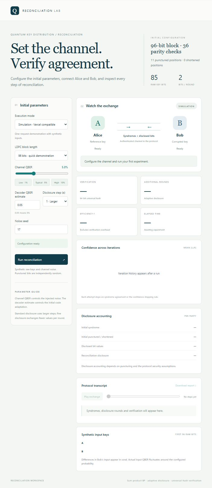

# Operational pipeline repair — 6 November 2026

The original project now includes **Alice-led AOPP → manually selected AD → symmetric blind information reconciliation**, with independently loaded inputs, genuine mTLS and durable layer checkpoints. See [REPAIR.md](REPAIR.md) for audit traceability, failure/retry behavior and remaining limits.

**Purpose: synthetic validation of the repaired SNS-QKD post-processing path.** SNS-QKD is the confirmed upstream protocol. Real-key acceptance is deliberately gated until the input stage/alignment/bit convention, parameter-estimation metadata, operating envelope, composable security budget and privacy-amplification interface are supplied. Do not treat successful synthetic reconciliation as approval for processing real keys. A user-supplied `input_kind=synthetic` is an operator assertion, not a detector of the origin of a bitstring.

## Start the repaired flow

Use Python 3.12 and install the existing development requirements. From this project folder:

```powershell
python -m pip install -r requirements-dev.txt
python tools/create_certs.py --out private
python tools/pipeline_demo_inputs.py --private private
```

Provisioning and demo generation refuse to overwrite existing files. Use a new directory if `private` already contains credentials or data. Keep each endpoint's directory on that endpoint's host. The operator bundle is an administrative credential, not either party's private key. On Windows, restrict private directories using ACLs; on Linux use owner-only permissions. Never commit private directories or databases.

In separate terminals, start Bob and Alice:

```powershell
python bob.py --config private/bob/config.json
python alice.py --config private/alice/config.json
```

Each backend loads only its own `private/<role>/DATA.txt`. Configure `input_file` and `state_dir` in its local config to use other paths. `load_config` resolves these relative to that config file. Defaults put private durable state in `private/<role>/pipeline-state/`.

Then start one workspace gateway per role, in separate terminals. Use a strong local workspace token of at least 24 characters. The token authorizes the operator; it does not replace mTLS between gateway/backends or between Alice and Bob.

```powershell
$env:OPERATOR_CONFIG=(Resolve-Path private/operator/config.json).Path
$env:WORKSPACE_TOKEN=Read-Host 'Workspace access token (24+ characters)'
$env:WORKSPACE_ROLE='alice'
python workspace.py --port 8081
```

For Bob's gateway use `WORKSPACE_ROLE='bob'` and `--port 8082`. Open Alice at `http://127.0.0.1:8081` and Bob at `http://127.0.0.1:8082`. The gateway HTTP listeners are loopback-only. For a hosted frontend, use an authenticated HTTPS gateway and validate the actual TLS termination point; do not expose this local HTTP server as a public key service.

1. On each workspace enter its token and the same fresh Run ID. **Connect / status** authenticates to that endpoint. A run initially shows NOT_LOADED.
2. Optionally upload each endpoint's own synthetic DATA.txt. UTF-8, optional BOM, only 0/1 with whitespace; no labels/commas. Limit 1 MB / 200,000 bits. Upload replaces the endpoint input file, not a previously committed run checkpoint. **Load local input for this run** snapshots each endpoint's own file. An existing Run ID cannot be reused for different input; use a new ID.
3. On Alice click **Run AOPP**. Alice generates nonoverlapping opposite-bit pairs; Bob returns 0=accepted / 1=rejected. Both retain the **first original bit** of each accepted pair in the same order. RKBP uses JSON two-element arrays and zero-based positions. PP is omitted; PP=2 is rejected.
4. Inspect the actual committed AOPP length N. On **both** workspaces manually select b, then click **Agree b on this endpoint**. Require b ≥ 2, b ≤ N, N % b = 0. Invalid divisibility changes neither checkpoint; choose another b without rerunning AOPP. If an earlier valid proposal may already be pending at the peer, resolve that proposal before changing settings.
5. On Alice click **Run AD**. One fresh random XOR mask bit is used per block. Bob accepts exactly constant differences (all-zero or all-one), and both retain their original first bit. No automatic divisor, padding, tail truncation or repeated AD construction is substituted. The implemented construction is one direct AD round.
6. On Alice click **Run symmetric blind reconciliation**. Both services run the original SBI engine, with actual syndrome/disclosure/verification exchange. The final partial codeword uses extra known shortened positions; all AD output bits are retained on success. Every block must pass the 64-bit verification check before the final pipeline candidate can be committed.
7. Both endpoints write their own accepted `<run_id>.bits` under `pipeline-state/`. Export only the redacted report from the browser. To remove a private checkpoint after use, invoke **Erase this endpoint's private checkpoint** on each side; saved accepted outputs and original DATA.txt are intentionally retained. Erase keeps a retired-ID tombstone and does not claim physical secure erasure.

The workspaces display committed counts, actual redacted events and pending/error states. They do not compute exact real-key QBER by sharing keys, invent live traffic, or display private key strips. Status can be polled during SBI processing. Output length equality is not a claim of bit-value equality before verification.

## CLI and verification

`pipeline_control.py` provides the same operations through the operator's mTLS client without reading private inputs. Example:

```powershell
python pipeline_control.py prepare --config private/operator/config.json --party alice --run check01
python pipeline_control.py prepare --config private/operator/config.json --party bob --run check01
python pipeline_control.py aopp --config private/operator/config.json --party alice --run check01
# Choose a valid b from the returned actual length, then select it on both sides.
python pipeline_control.py select_ad --config private/operator/config.json --party alice --run check01 --b 2
python pipeline_control.py select_ad --config private/operator/config.json --party bob --run check01 --b 2
python pipeline_control.py ad --config private/operator/config.json --party alice --run check01
python pipeline_control.py sbi --config private/operator/config.json --party alice --run check01
python -m unittest discover -s tests -v
node --check web/workspace.js
```

The repaired pipeline preserves committed SQLite state across backend restarts. Layer commits are retryable after acknowledgment loss, but simultaneous cross-server commits are impossible to guarantee under arbitrary network failure. A pending layer must be retried before advancing. Interrupted SBI restarts from AD with a fresh attempt, not from an unverified mid-block candidate. Final output publication uses an fsynced temporary file, then no-overwrite atomic rename on Windows or hard-link publication on POSIX; unsupported storage fails closed. Do not run multiple backend replicas against the same state directory. Protect checkpoint files/backups as private key material; storage is not application-encrypted.

The default small LDPC pool, q_est=.02 and alpha=1 are **development defaults**, not parameters inferred for the user's SNS source. General AD b support does not imply the supplied paper's finite-key proof applies to every b. Its direct size-2 treatment and described repeated-size-2 extension must be distinguished from one larger direct block. Read the original limitations below and REPAIR.md before defining a real operating contract.

## Legacy demonstration

The historical `demo.py`, `dashboard.py`, original `web/index.html` and existing `/api` demo handler remain available for old synthetic demonstrations/tests. They centrally generate synthetic inputs and are **not the repaired operational workspace**. Use `workspace.py` for the new path. No public deployment was changed by the repair; the earlier QKD_Observatory Vercel apps are separate and are not evidence that these new backends have been deployed.

---

## Original demonstration documentation (historical)

# QKD Reconciliation Lab

A Python implementation of symmetric blind information reconciliation with separate Alice and Bob HTTPS services, mutual TLS, and a presentation dashboard.

The protocol follows Appendices A and B of [Kiktenko et al., arXiv:1612.03673v2](https://arxiv.org/abs/1612.03673v2). It uses the sum-product BP engine provided by [`ldpc`](https://github.com/quantumgizmos/ldpc), on which [`bposd`](https://pypi.org/project/bposd/) depends. OSD is not used.



This implements classical information reconciliation. It does not implement the optical/quantum channel, parameter-estimation security analysis, privacy amplification, or a complete production QKD system. A verified reconciled block is not automatically a secret key.

## Start the presentation dashboard

Use Python 3.12. From this repository:

```sh
python -m venv .venv
```

Activate the environment on Windows:

```powershell
.venv\Scripts\Activate.ps1
```

On Linux/macOS:

```sh
. .venv/bin/activate
```

Then:

```sh
python -m pip install -r requirements-dev.txt
python demo.py
```

Open [http://127.0.0.1:8080](http://127.0.0.1:8080). Run an experiment, inspect the confidence chart, play the transcript, and download the JSON report. The interface labels simulation and live mTLS separately.

The initial-parameter workspace previews the selected parity-check count, raw-key capacity, puncturing/shortening counts and disclosure size before running. Low/typical/high noise presets set both channel QBER and the decoder estimate; they can also be adjusted independently. Invalid configurations disable the run button and explain what to correct. The interface contains no paper title, author names or research citations; source attribution stays in this README.

The noise seed generates repeatable synthetic raw keys and channel errors. Punctured bits use independent operating-system randomness at each party, so disclosure paths can differ between runs with the same noise seed. The reported observed QBER is measured on the synthetic inputs; code selection uses the separately entered estimated QBER.

## Live demonstration with two Python services

Generate separate certificate bundles:

```sh
python tools/create_certs.py
```

Start Bob in one terminal:

```sh
python bob.py --config private/bob/config.json
```

Start Alice in another:

```sh
python alice.py --config private/alice/config.json
```

Start the dashboard with its operator identity. In PowerShell:

```powershell
$env:OPERATOR_CONFIG = "private/operator/config.json"
$env:DEMO_TOKEN = python -c "import secrets; print(secrets.token_urlsafe(32))"
$env:DEMO_TOKEN
python demo.py
```

In a POSIX shell:

```sh
export OPERATOR_CONFIG=private/operator/config.json
export DEMO_TOKEN="$(python -c 'import secrets; print(secrets.token_urlsafe(32))')"
printf '%s\n' "$DEMO_TOKEN"
python demo.py
```

Choose **Live servers · mTLS** in the dashboard and enter the operator token. Both servers must be running. The dashboard generates synthetic inputs, provisions each party through its certificate-authenticated administrative endpoint, asks Alice to run the protocol, and fetches summaries. It deletes the in-memory demonstration sessions afterwards. Bob retains a verified corrected block in his local output directory.

The dashboard is bound to loopback by default. Its local browser connection is ordinary HTTP; the live operator-to-server and Alice-to-Bob connections are mTLS HTTPS. If you expose the dashboard beyond your own computer, place it behind an HTTPS/authenticated gateway. The operator token is required for live control. This token is not a substitute for mTLS on the party services.

## Deploy Alice and Bob on different servers

Generate certificates for the DNS names clients will actually use:

```sh
python tools/create_certs.py --out private-remote --alice-host alice.example.org --bob-host bob.example.org
```

Use an empty output directory. The tool refuses to overwrite existing key material. Add `private-remote/` to your own ignore rules, or generate outside the repository. Only the default `private/` directory is ignored by name; all PEM/key/bit files are separately ignored as well.

Distribute the `alice` bundle only to Alice's server, the `bob` bundle only to Bob's server, and the `operator` bundle only to the trusted controller. The operator private key does not belong on either party server. The CA signing key is not saved by the development certificate generator. To renew this development PKI, regenerate bundles and update all pins. Use your organization's PKI and certificate lifecycle for sustained deployments.

Install `requirements.txt` on each server and run its corresponding script with that server's config path. The generated server configurations bind to `0.0.0.0`, with Alice on port 8443 and Bob on 8444. Restrict network access to the intended peers/operator. Peer origins in the config must match certificate SANs. Both machines require the same code, matrices, parameters, and dependency versions.

If a reverse proxy sits in front, it must preserve end-to-end TLS to the Python listener, for example by TCP passthrough. An HTTP proxy that merely forwards a client-certificate header is not supported or trusted by this implementation.

Each server uses in-memory sessions, a 15-minute expiry, and a maximum of 16 sessions. Run a single service process per party; load balancing between independent processes would lose session state. Restarting a server aborts active sessions. State is not a durable distributed database. For long-term deployment, run the process under your service manager and protect the private output directory. POSIX key/output files are created with mode 0600; configure equivalent Windows ACLs yourself.

### Docker

The Docker image contains the service code and runtime dependencies, not certificates. To test `compose.yaml`, generate certificates with both host names set to `host.docker.internal` so the containers can reach the published host ports:

```sh
python tools/create_certs.py --alice-host host.docker.internal --bob-host host.docker.internal
docker compose up --build
```

Use fresh bundles rather than overwriting an existing `private/`. The compose file is a local two-container topology. On separate servers, mount only the corresponding party bundle and configure each actual peer DNS name. Docker configuration is included; container execution is a separate check from the Python integration tests.

## Supply inputs without the dashboard

The raw key is a string of `0` and `1` characters in a local file. Bob's raw block must have exactly the same length as Alice's. Only the operator can provision inputs; the peer never receives the other complete raw key.

For a synthetic CLI test:

```sh
python tools/make_inputs.py
```

Copy its `session_id`, or read `private/inputs/session.txt`. Replace `SESSION_ID` below with that value:

```sh
python control.py prepare --party alice --config private/operator/config.json --session SESSION_ID --spec private/inputs/spec.json --key-file private/inputs/alice.bits
python control.py prepare --party bob --config private/operator/config.json --session SESSION_ID --spec private/inputs/spec.json --key-file private/inputs/bob.bits
python control.py run --party alice --config private/operator/config.json --session SESSION_ID
python control.py result --party bob --config private/operator/config.json --session SESSION_ID
```

After successful verification, Bob writes the corrected raw key to `output/SESSION_ID.bits` relative to his configuration directory. No raw or corrected key is returned by `/result`. Verification failures do not produce a key file. `control.py delete` removes in-memory session state; it does not erase Bob's local output file.

For real inputs, provision each block through your trusted administration process. The demonstration controller deliberately knows both synthetic inputs. It should not be used as a production key-ingestion service for real QKD material.

### Import a code pool

The included small Gallager matrices are constructed for interactive demonstrations; they are not the IEEE 802.11n or 4000-bit matrices used for the paper's plots. Therefore this repository does not claim to reproduce the reported efficiency improvements, FER, or timing results.

An imported pool is a JSON list:

```json
[
  {"name": "My LDPC code", "H": [[1, 1, 0, 1], [0, 1, 1, 1]]}
]
```

Use `python tools/make_inputs.py --pool path/to/pool.json`. Supply your own validated matrices for scientific experiments. The paper's authors also published [their original simulation and code data](https://github.com/RQC-QKD-Software/symmetric-reconciliation). Those files are not redistributed here. For nonsynthetic keys, `protocol.choose_spec` selects the public configuration first; then each party takes a raw block of the required length from its own source.

## Vercel deployment

The repository root contains `vercel.json`, a static `web/` directory, and the Python function `api/index.py`. Upload this repository to GitHub, import it into Vercel, and select this directory as the project root. The included output directory is `web`, and `/api` is routed to the Python function. Python 3.12 is selected by `.python-version`. There is no Node build and no frontend package installation.

The deployable Vercel experience is the **simulation dashboard and Python simulation API**. It has no server-local session dependency between requests. Its synthetic state exists only for the duration of a single request; replay occurs in the browser after the completed transcript returns.

Do not deploy `alice.py`/`bob.py` as if they were Vercel functions and call that mTLS. These scripts own a TLS socket and require client certificates during the handshake. Vercel terminates incoming TLS at its infrastructure and loads Python HTTP handlers; this deployment does not give the scripts control over that TLS listener. Consequently the full two-server mTLS topology requires separate hosts that expose those listeners. Vercel may host the demonstration frontend while the two services run elsewhere, but this repository's live control configuration is deliberately a local/private controller file, not uploaded PEM secrets.

Leave `OPERATOR_CONFIG` and `DEMO_TOKEN` unset on the Vercel simulation deployment. Private certificates, raw keys, and output keys are excluded from Git, Docker build contexts, and Vercel uploads. The zip deliverable also excludes generated secrets.

The Vercel Hobby plan is restricted to personal/noncommercial use; a workplace/business demonstration is not automatically eligible for that plan. Verify your use against [Vercel's plan terms](https://vercel.com/docs/plans/hobby). This project is prepared for deployment, but no Vercel/GitHub deployment is performed by the source code itself. See also [Python runtime](https://vercel.com/docs/functions/runtimes/python), [TLS termination](https://vercel.com/docs/how-vercel-cdn-works), and [function limits](https://vercel.com/docs/functions/limitations). The configured function timeout is an operational ceiling, not a BP convergence rule.

## How the protocol works

1. **Choose a code.** For every candidate parity-check matrix, calculate shortening or puncturing from Appendix A, Eqs. A1/A2 with starting efficiency 1. Select the candidate carrying the largest raw-key block. Disclosure step size follows Eq. 6, `ceil(n * (0.0280 - 0.02 * R) * alpha)`, with nominal rate `R = 1 - m/n` as in the paper.
2. **Choose positions.** A seeded permutation synchronizes the parties' position choices. A greedy untainted set is used when it is large enough; otherwise a synchronized random puncture set is used, as Appendix A permits. Shortening and puncturing are alternatives at initialization.
3. **Extend keys.** Insert zeros at initially shortened positions and independent random values at punctured positions. Preserve the original raw positions so Bob can remove the original padding at the end.
4. **Exchange syndromes.** Each party sends `H @ extended_key mod 2`. Both calculate the same relative syndrome by XORing the two syndromes and initialize the error estimate to zero.
5. **Decode independently.** Both run Appendix B with the same relative syndrome, QBER estimate, error estimate, and current S/P sets. Matching outcomes are checked explicitly.
6. **Disclose after failure.** Send each party's values at the decoder's D positions. Both set `e[D] = x_ext[D] XOR y_ext[D]`, add D to S, remove D from P, and retry. D is selected from all positions according to the printed Eq. B13; no extra exclusion or puncture-priority heuristic is added.
7. **Correct Bob's key.** XOR Bob's extended key with the decoded error vector, then retain only the original raw positions. Alice's raw key is unchanged.
8. **Verify.** Compare a 64-bit Toeplitz universal-hash tag of the raw reconciled block using an independent public seed. On mismatch the block is rejected. The paper requests universal-hash verification but does not prescribe this concrete Toeplitz construction or tag length; those are explicit implementation choices.

Alice initiates one HTTPS request per logical round, and Bob returns his corresponding data in the response. Both still calculate the same relative syndrome and perform BP independently. The paper describes simultaneous symmetric messages; this simple request/response transport carries the same logical information but does not reproduce that simultaneous timing. No performance comparison should equate its elapsed time to the paper's communication model.

The universal-hash collision probability for a fixed unequal pair is at most `2^-64` with an independent uniformly random seed. A successful hash comparison is probabilistic verification, not a proof that every accepted candidate equals the actual error. The simulation additionally compares the corrected key against synthetic ground truth, without adding that knowledge to the decoder.

## Appendix B implementation details

`bp.py` exposes the earlier `decode(s, e, H, q_est, S, P, d)` tuple interface and `decode_result` for iteration history. Positions are zero-based Python indexes.

Initial LLRs are exactly the stated raw-bit log odds with the sign from `e`, finite signed magnitude 100 at shortened positions, and zero at punctured positions. A hard decision uses 0 at a zero LLR. Syndrome agreement is checked before the confidence failure criterion. Average absolute LLR excludes shortened positions and includes punctures.

Eq. B7 as printed omits the inner `tanh`; this code implements the stated sum-product algorithm, including that inner `tanh`. Eqs. B8 and B14 are the usual posterior and extrinsic updates. There is no OSD, min-sum approximation, damping, or LLR clipping.

The paper does not specify startup of the five-value confidence window or how equal-magnitude disclosure ties are ordered. This implementation first evaluates B12 at k=5 using confidence values from k=0 through k=4, and uses increasing position order for exactly equal computed magnitudes. Floating-point roundoff can break mathematical ties.

The public native BP API has no single-iteration continuation or way to replace its zero-LLR early-stop decision. The adapter appends an isolated zero row with syndrome 1, preventing native early exit without adding any Tanner-graph edge or message. It replays k native iterations from the same priors to obtain the kth state, then applies the paper's decisions itself. This has quadratic replay overhead and is intended for understandable demonstrations, not high-throughput QKD hardware.

A binary change of variables maps signed initial LLRs to nonnegative native priors and transforms the syndrome consistently. This avoids rounding a shortened-bit probability to 1 when the desired prior LLR is -100.

The stock engine can still generate nonfinite LLRs because `tanh(100/2)` rounds to 1. When this happens, the implementation reconstructs the kth message state from the same initial priors using the algebraically equivalent stable box-plus expression, then continues with that arithmetic. It is the same sum-product BP update, not an additional decoder or search. The report records which attempts needed stable arithmetic. This corrects a limitation of the earlier wrapper; it cannot create bit-for-bit agreement between all floating-point implementations.

The decoder has no extra iteration-count convergence criterion. Services impose a 20-second per-attempt computation deadline and abort on expiration; an abort is not reported as BP convergence or as the paper's confidence failure. Degenerate input producing undefined arithmetic or an all-shortened inconsistent syndrome is rejected. If the paper's unfiltered D contains no new positions, the service aborts rather than endlessly disclosing the same bits. These operational rejection paths are reported as errors.

## Authentication and message handling

Each TLS listener requires a certificate signed by the configured CA. After handshake, the service checks the certificate's SHA-256 fingerprint against the configured peer/operator identities. The outbound client checks the CA, server hostname, and expected server certificate fingerprint. It never uses `verify=False` and never trusts a claimed identity in a JSON field or HTTP header.

Only Alice's peer certificate may call Bob's `/exchange` endpoint. Only the operator certificate may prepare inputs, start a run, read summaries, or delete a session. The development certificates have 30-day validity, distinct private keys, and role-appropriate extended key usages. Both peers support TLS 1.2 or later.

Protocol messages bind a random session ID, configuration digest and increasing sequence number. Duplicate identical exchange requests return cached responses. Reusing a sequence number with different data or using a different public configuration is rejected. This supports retransmitting a response lost in transit; automatic network retries are not hidden inside the transport. Rerun `/run` after a transient network failure while both sessions still exist. Completed runs are idempotent. A party-process restart requires a new session.

TLS authenticates computationally using PKI assumptions. It does not provide the information-theoretic authentication treatment of a fully analyzed QKD implementation. The dashboard/control service is a trusted operator, not a third reconciliation participant.

## Leakage and reported efficiency

The dashboard reports Eq. 4's formal efficiency using the estimated QBER. The paper leakage expression is `m - p0 + disclosed_per_party`, excluding the verification tag. The interface displays it only when the selected punctures pass the checked untainted condition. It remains conditional on the paper's Appendix C security assumptions and is not a new composable finite-key proof.

When random punctures do not pass that condition, the report withholds the paper leakage value and shows a conservative count of the two syndrome/disclosure directions plus the 64-bit tag. The public independent hash seed and public control metadata are not counted as key-dependent disclosed bit values. A formal security treatment must analyze the complete authenticated transcript, rank dependencies, parameter estimation and privacy amplification before deriving final key length. No positive secret-key rate is asserted by this demo.

## Files

| File | Responsibility |
| --- | --- |
| `alice.py`, `bob.py` | Separate deployable service entry points |
| `server.py` | mTLS listener, role authorization and session message handling |
| `transport.py` | Verified HTTPS client, identity pins and configuration loading |
| `protocol.py` | Code selection, extension, rounds, correction, verification and metrics |
| `bp.py` | Appendix B decoder using native/stable sum-product arithmetic |
| `dashboard.py`, `demo.py` | Presentation API and local HTTP launcher |
| `api/index.py` | Vercel Python handler |
| `web/` | Interactive dashboard without frontend dependencies |
| `tools/create_certs.py` | Independent development PKI bundles |
| `tools/make_inputs.py`, `control.py` | Synthetic inputs and trusted CLI provisioning |
| `tests/` | Equation, protocol, HTTPS/mTLS and dashboard checks |

The Python and frontend source files intentionally contain no explanatory comments; the explanations are in this README.

## Tests and GitHub

```sh
python -m unittest discover -s tests -v
node --check web/app.js
```

The tests compare native BP trajectories on 100 graphs against independent equations, check stable updates against high-precision arithmetic, exercise shortening/puncturing and the confidence window, reconcile several block sizes, verify the local corrected output, and use actual loopback TLS sockets to test authentication, pinning, duplicate messages and configuration mismatches. The browser dashboard also has API/static-route tests. A socket permission error means the environment denied networking; it is not a successful TLS rejection test.

Browser verification covers a successful interactive run, the high-noise preset, initial-configuration updates, invalid-QBER feedback, disabled execution for invalid settings, and transcript playback. The inspected browser console had no JavaScript errors. The included screenshots show the tested initial workspace and a verified demonstration run. Vercel and Docker configuration are prepared but were not deployed/executed as part of local verification.

Local validation on November 4, 2026: all 24 automated tests passed on Python 3.12, including the two-process mTLS test. JavaScript syntax, Python syntax, absence of Python comments, and absence of generated credentials in the deliverable were checked separately. These checks validate this implementation and its tested inputs; they do not establish a production QKD security proof or reproduce published performance results.

GitHub Actions runs the tests on Python 3.12. To create your own repository:

```sh
git init
git add .
git commit -m "Add symmetric blind reconciliation demo"
git branch -M main
git remote add origin https://github.com/YOUR_ACCOUNT/YOUR_REPOSITORY.git
git push -u origin main
```

Review the staged files before pushing. The delivered archive has no generated certificates, private keys, raw-key files or session outputs. Test the service topology again on your chosen hosts and TLS/network configuration before presenting it as a deployed system.
